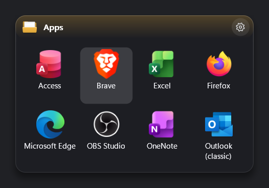
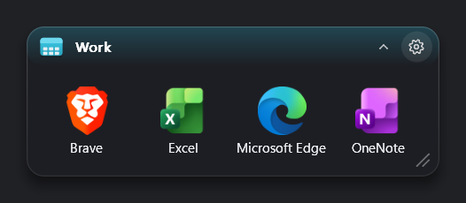
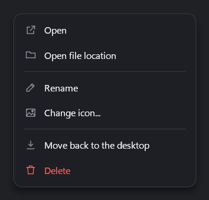
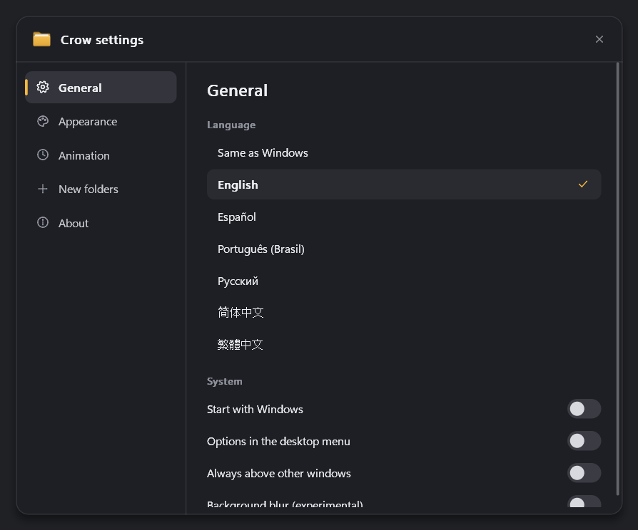
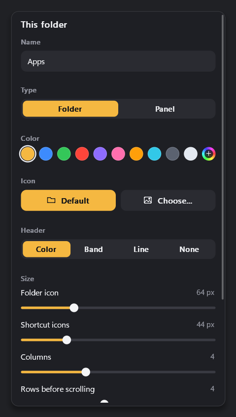

# Crow

A tiny, highly customizable desktop folder organizer for Windows. Group your shortcuts into folders that open when you hover over them, or keep them in panels that stay open.



<p>
  
  
</p>

## Features

- Folders open as soon as the pointer settles on them, with a smooth animation. Any folder can also be a panel that stays open.
- Drag shortcuts from the desktop or Explorer onto a folder to move them in. Drag them out to put them back on the desktop.
- Click a folder name to rename it right there.
- A settings button appears in the corner of each folder, with colors, icons, sizes and layout. Changes show up live.
- Use your own PNG, ICO, JPG or SVG icons for folders and single shortcuts. Single color SVG icons can be tinted.
- A settings window for the language, appearance, animation speed and the defaults for new folders.
- Available in English, Español, Português (Brasil), Русский, 简体中文 and 繁體中文.

<p>
  
  
</p>

## Footprint

| | |
|---|---|
| crow.exe | about 250 KB |
| Memory when idle | about 70 KB |
| CPU when idle | 0% |

## Building

You need [Rust](https://rustup.rs).

```sh
rustup target add x86_64-pc-windows-msvc
cargo build --release
```
